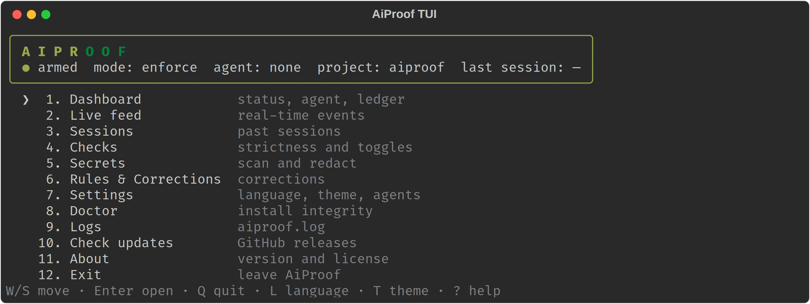

# AiProof by SYSIK

<p align="center">
  
</p>

> **The agent says "done". AiProof checks the receipts.**

AiProof is a local, offline **verification layer for AI coding agents**. It watches what an
agent *claims* it did, compares those claims against **real evidence** (git, test output, the
filesystem, the ledger), and — in interactive agents that expose lifecycle hooks — **blocks
the agent's "I'm finished"** until the claims are honest.

It never phones home. It never stores your code. Secrets that pass through it are
**redacted before they ever touch disk**.

```
$ aiproof status
● AiProof by SYSIK — armed
  mode: enforce
  project: /home/you/project
  pinned: ok
  agents: claude-code
```



---

## Why this exists

LLM agents are optimistic. A very common failure mode looks like this:

```
Agent: "All tests pass, committed the fix as 9f2c1a4."
Reality: tests were never run; the "commit" doesn't exist; one test file was deleted.
```

AiProof turns that into a hard stop:

```
AiProof verified your claims and found problems:
- You claimed the tests pass, but no test command was run this session.
- You claimed a commit, but no matching commit exists on the current branch.
- Test tampering detected: deleted test file(s): tests/test_auth.py

Fix the above, then run the full test command and report exact counts.
```

Everything is deterministic and local. No telemetry, no cloud; the only network call is
the explicit `aiproof update --check`.

---

## 60-second demo

```bash
pipx install "git+https://github.com/SysikNagibator/AiProof.git@v0.1.0"
cd your-project
aiproof init            # install hooks, freeze pinned settings, start the ledger
aiproof doctor          # verify the install
# ... work with Claude Code as usual ...
# when the agent says "done", AiProof checks it.
aiproof show            # render the session receipt
```

The gate reacts in the agent's own "I'm done" moment:

```
AiProof verified your claims and found problems:
- You claimed 42 tests pass, but the last run reported 31.
- Test tampering detected: weakened assertion(s): tests/test_auth.py
```

---

## What it verifies

| Claim | How it is checked |
| --- | --- |
| "all tests pass" | a test command actually ran this session; parsed pass/fail counts; claimed counts must be met |
| "I committed ..." | the commit object exists, is reachable from the current branch, and touches the claimed files |
| "I created/updated file X" | the file really differs from the session-start snapshot / baseline commit |
| "added tests" | new test definitions are present in the diff |
| (integrity) test tampering | deleted test files/cases, new `skip`/`xfail`/`only` markers, weakened assertions |
| (integrity) secrets | secrets in the staged/unstaged/untracked diff and in agent instruction files |
| (integrity) TODO integrity | `TODO`/task-list items deleted rather than completed |
| (integrity) config integrity | pinned settings and protected agent/MCP files unchanged |
| (integrity) learned rules | rules compiled from your corrections (see below) are not violated |

Claims are extracted **deterministically** from the agent's final message in 11 languages
(en, ru, uk, de, es, fr, pt-BR, zh-CN, ja, ko, tr) — no model in the loop. The claim
language packs use the short codes `pt`/`zh`; only the UI catalogs are `pt_br`/`zh_cn`.

See [`docs/CHECKS.md`](docs/CHECKS.md) and [`docs/CLAIMS.md`](docs/CLAIMS.md).

---

## Learn from corrections (Phase 2)

Tell AiProof what the agent got wrong, and it can turn that into an **executable check**:

```bash
aiproof correct "Do not mock the database in integration tests"
aiproof learn compile --write               # → a disabled rule
aiproof learn backtest no-db-mock-in-integration
aiproof learn enable no-db-mock-in-integration   # human-only, interactive TTY
aiproof learn export                        # write the AGENTS.md rules block
```

From then on the `learn_rules` check blocks that exact mistake. Corrections that cannot be
expressed as a rule stay **advisory** and are labelled "not enforced" everywhere.
Full pipeline, DSL and honest backtest limits: [`docs/LEARN.md`](docs/LEARN.md).

---

## Install

> **Not on PyPI/npm yet.** The Python distribution name `aiproof-sysik` and the npm name
> `aiproof-sysik` are reserved for us, but **nothing is published there today** (verified
> 2026-11-17). Install from GitHub until the first registry release. Do **not** run
> `pipx install aiproof-sysik` yet — it does not exist and will fail.

```bash
# recommended: isolated CLI, pinned to a release tag
pipx install "git+https://github.com/SysikNagibator/AiProof.git@v0.1.0"

# or with pip (same command is exposed: `aiproof`)
pip install "git+https://github.com/SysikNagibator/AiProof.git@v0.1.0"

# or the prebuilt wheel from the release page
pip install https://github.com/SysikNagibator/AiProof/releases/download/v0.1.0/aiproof_sysik-0.1.0-py3-none-any.whl

# or from a clone
git clone https://github.com/SysikNagibator/AiProof.git
cd AiProof && pip install .
```

Prebuilt single-file binaries for Linux/macOS/Windows are attached to each
[release](https://github.com/SysikNagibator/AiProof/releases) with `SHA256SUMS`.

> **Note on the CLI name.** The command is `aiproof`. PyPI already has an unrelated package
> literally named `aiproof`, so ours will be **`aiproof-sysik`** once published. See
> [`docs/DECISIONS.md`](docs/DECISIONS.md).

Node users: an `npx` shim lives in [`npm/`](npm/) (also unpublished — run it from a clone in
the meantime). Prebuilt binaries and the wheel are produced by the release workflow.

---

## Quick start

```bash
cd your-project
aiproof init                 # install hooks, write pinned settings, create the ledger
aiproof doctor               # verify the install
aiproof status               # show armed state

# ... use your agent normally. When it says "done", AiProof checks it.

aiproof show                 # render the latest session receipt
aiproof ledger verify        # re-check the hash-chained ledger
aiproof tui                  # open the dashboard
```

`aiproof init` is idempotent and only edits AiProof's own hook entries. A `.bak` backup is
written next to any file it touches.

---

## Supported agents & IDEs

AiProof is deliberately honest about how deeply it can integrate with each tool:

- **native-hooks** — can observe lifecycle events and **block** a bad "done" (Claude Code is
  verified; other native-hook entries are planned or unverified pending vendor-doc
  verification).
- **mcp-only** — exposes read-only self-check tools over MCP; cannot block.
- **wrapper** — post-hoc verification via `aiproof run -- <agent command>`.

49 agents are registered (11 native-hooks, 29 mcp-only, 9 wrapper). Run
`aiproof install --list-ides` for the full list, or see
[`docs/AGENTS_SUPPORT.md`](docs/AGENTS_SUPPORT.md). The machine-readable registry is
[`src/aiproof/adapters/registry.py`](src/aiproof/adapters/registry.py).

> Integration details are marked `verified` **only** after the vendor's current
> documentation has been read and dated. We never invent hook event names, config paths or
> flags. Currently Claude Code (native hooks) and the generic wrapper are `verified`
> (2026-11-16).

### Wrapper mode works everywhere

For any CLI agent:

```bash
aiproof run -- aider --message "fix the failing test"
```

AiProof snapshots git before/after and prints a post-hoc verdict of the agent's claims.
Wrapper mode is **post-hoc**: it cannot block a running session. Its exit code mirrors the
agent's, except that a blocking verdict returns `1` when the agent exited `0`.

---

## How it works

```
agent ──▶ hook (stdin JSON) ──▶ normalize ──▶ ledger (redacted, hash-chained)
                                                    │
              Stop / "done" ──▶ extract claims ──▶ run checks ──▶ block? ──▶ agent
```

- **Ledger** — an append-only, hash-chained JSONL log per project, so no one (agent
  included) can rewrite history undetected. `aiproof ledger verify` recomputes it.
- **Pins** — gate-critical settings (strictness, checks, protected paths, test command) are
  frozen in a pinned file whose hash is self-checked. Editing a repo config file cannot relax
  the gate.
- **Redaction** — every value written to the ledger passes through pattern + entropy
  redaction. Placeholders are stable but non-reversible.
- **Fail-open** — if AiProof itself errors, the agent is never bricked; the error is logged
  and surfaced in `status`/`doctor`.

Full design: [`docs/ARCHITECTURE.md`](docs/ARCHITECTURE.md) ·
[`docs/THREAT_MODEL.md`](docs/THREAT_MODEL.md) · [`docs/LEDGER.md`](docs/LEDGER.md) ·
[`docs/HOOKS.md`](docs/HOOKS.md) · [`docs/MCP.md`](docs/MCP.md).

---

## Modes

`strictness` selects how aggressive the gate is:

| mode | behaviour |
| --- | --- |
| `observe` | record everything, never block |
| `warn` | record + explain, never block |
| `enforce` | block on failures (default) |
| `strict` | block on failures **and** anything unverifiable |

`aiproof pause 30` (human-only, interactive TTY) temporarily disarms the gate.

---

## The benchmark

We publish real, reproducible numbers measured on this codebase — no marketing:

```bash
aiproof bench
```

31 deterministic scenarios (25 attack/positive, 6 benign/negative) across test tampering,
fake commits, secret leaks, config tampering, ledger tampering, multilingual false claims, a
monorepo latency check, the gate cap, and a learned-rule block. See
[`docs/BENCH.md`](docs/BENCH.md) and the generated
[`docs/BENCH_RESULTS.md`](docs/BENCH_RESULTS.md).

| metric | value |
| --- | --- |
| detection rate | **96%** (24/25 positives; the miss is scenario 5, below) |
| false-positive rate | **0%** (6/6 negatives correctly allowed) |
| median hook latency | **~70 ms** median over 31 scenarios on an idle Linux x86_64 VM (host-dependent) |

Reproduce it yourself — the verdicts are deterministic; only the timings vary:

```bash
aiproof bench          # table
aiproof bench --json   # machine-readable
```

---

## Limitations and threat model

AiProof is a **risk-reduction and honesty tool, not a security boundary.** Be precise about
what it does and does not do:

- **Only Claude Code can be blocked today.** Every other integration is `mcp-only`
  (read-only self-help) or `wrapper` (post-hoc). See
  [`docs/AGENTS_SUPPORT.md`](docs/AGENTS_SUPPORT.md).
- **The ledger detects tampering, it does not prevent it.** A plain hash chain stops *silent*
  edits; an attacker who can rewrite every later record can forge it. HMAC and receipt
  signatures are **not implemented yet** — they are reserved (`paths.key_path()`, `[sign]`
  extra). See [`docs/LEDGER.md`](docs/LEDGER.md) and [`docs/SIGNING.md`](docs/SIGNING.md).
- **Deny lists are heuristics.** A determined agent with shell access can defeat string
  matching; `config_integrity` re-verifies protected files at Stop as a second line.
- **One honest miss.** Scenario 5 (a hardcoded lookup table replacing logic) is a heuristic
  and is not caught — it is listed here, not hidden.
- **Backtest false positives are a lower bound.** Without labelled history AiProof counts only
  explicit `aiproof:ignore` waivers. It says so in every result.
- **TUI screens are mostly read-only.** The CLI has the full actions (`checks`, `scan`,
  `learn`, `setup`, …); the TUI currently renders them without edits. `/` filter and mouse
  handling are not implemented. See [`docs/TUI.md`](docs/TUI.md).
- **Only en/ru catalogs are reviewed.** Nine catalogs ship complete but as machine drafts.

Full analysis: [`docs/THREAT_MODEL.md`](docs/THREAT_MODEL.md).

---

## How it compares

AiProof is not the first "don't trust the agent's done" tool. The closest projects are
**isitdone** and **agent-guard-hooks**; we name them here instead of hiding behind abstract
categories. Feature sets move fast — the facts below were checked on **2026-11-17** against
each project's own docs/registry entry; verify before relying on it.

| | **AiProof** | **isitdone** | **agent-guard-hooks** |
| --- | --- | --- | --- |
| what it is | verify the agent's *claims* against evidence | run the repo's *real* checks and refuse "done" until they pass | a bundle of *behavior guardrails* |
| offline / zero-LLM / no telemetry | **yes** | yes (zero-dep, no network) | yes (Python stdlib only) |
| runs your test / lint / typecheck suite | **no** — it checks claims, it does not execute your suite | **yes** (the repo's real commands) | partly (re-runs tests for mutation checks) |
| verifies the agent's *claim wording* vs evidence (counts, commit, files) | **yes** (11 languages) | no | no |
| blocks a false "done" mid-session | **yes** (Claude Code, verified) | yes (Stop hook) | yes (Stop hook) |
| stops the agent from relaxing *your* guard config | **yes** — pinned settings + `config_integrity` + tamper guard on protected paths | no (not its focus) | partly (outbound-action denylist + user allowlist) |
| learns executable rules from your corrections + backtest on history | **yes** (`aiproof correct` → `learn compile` → `learn backtest`) | no | no |
| audit trail | hash-chained, redacted ledger + receipts | git-bound receipt | audit log |
| agents with *blocking* support | 1 verified (Claude Code) + wrapper everywhere (49 registered, honestly labelled) | ~12 (Claude Code, Codex, Cursor, Gemini, …) | 3 (Claude Code, Codex CLI, Gemini CLI) |
| dependencies | `rich`, `wcwidth`, `tomli-w` | none (Node) | none (Python stdlib) |

They **compose**: let isitdone or agent-guard run your suite and block on red tests, and let
AiProof verify the agent's *claims* (test counts, commits, files), keep your guard config
tamper-evident, and learn rules from your corrections. AiProof does **not** try to replace a
real test run.

> We also looked for **Calx** and **Reflex** in this niche. As of 2026-11-17 there is no
> verifiable AI-coding-agent *verification* project by those names: PyPI/npm `calx` and
> `reflex` are an unrelated spreadsheet engine and web framework, and GitHub `calx`/`reflex`
> repos are a spreadsheet/CLI/language/game library and the Reflex web framework. If you meant
> specific repos, open an issue with links and we will add an honest column — we do not invent
> competitor features.

The point of AiProof is narrow and honest: catch the agent lying about *this session*, with
evidence you can inspect, on your machine.

---

## Privacy

- 100% local by default. No analytics; the only network call is `aiproof update --check`.
- The ledger stores **redacted** payloads, never raw source and never secrets.
- Test counts / commit hashes are the only "code-adjacent" facts retained, and they live
  under `~/.aiproof/projects/<hash>/`.

---

## Roadmap

- **Verified adapters** — read and implement more agents' real hook APIs (each with a
  recorded verification date), starting with the `unverified` native-hooks entries.
- **Receipt signatures** — ed25519 over the chain head, public key shipped with releases.
- **Code-signed binaries** — Windows/macOS signing and notarization.
- **TUI gaps** — list filtering and optional mouse support.
- **Reviewed catalogs** — promote machine drafts to reviewed translations.
- **Optional local web dashboard** (`aiproof ui --web`, bound to `127.0.0.1`).

---

## Development

```bash
python -m venv .venv && . .venv/bin/activate
pip install -e ".[dev]"
pytest
ruff check .
mypy
```

See [`docs/CONTRIBUTING.md`](docs/CONTRIBUTING.md). Tests never hit the network, and every
check has both a positive and a negative fixture.

---

## License

MIT © SYSIK. See [`LICENSE`](LICENSE).

Русская версия: [`README_RU.md`](README_RU.md).
