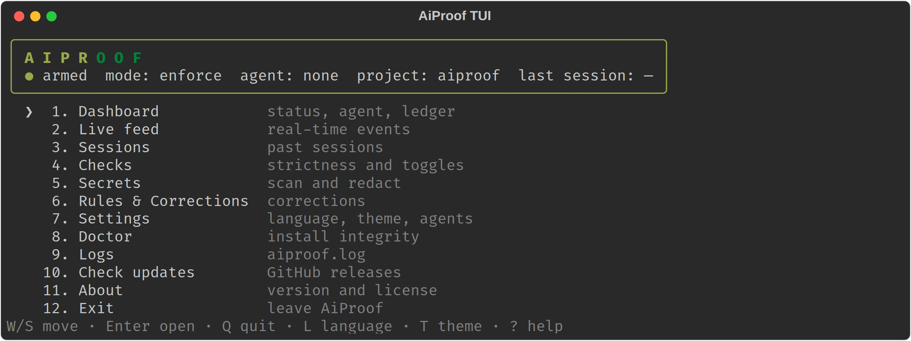

# AiProof by SYSIK

<p align="center">
  
</p>

> **Агент говорит «готово». AiProof проверяет доказательства.**

AiProof — локальный офлайн-слой **проверки утверждений ИИ-агентов**. Он следит за тем, что
агент *заявляет*, сопоставляет эти утверждения с **реальными доказательствами** (git, вывод
тестов, файловая система, журнал) и — в интерактивных агентах с хуками жизненного цикла —
**блокирует «я закончил»**, пока утверждения не станут честными.

Он никуда не звонит. Он не хранит ваш код. Секреты, проходящие через него, **вымарываются
ещё до записи на диск**.

```
$ aiproof status
● AiProof by SYSIK — защищено
  режим: enforce
  проект: /home/you/project
  пины: ok
  агенты: claude-code
```



---

## Зачем это нужно

LLM-агенты оптимистичны. Типичный сбой выглядит так:

```
Агент: «Все тесты проходят, закоммитил фикс как 9f2c1a4.»
Реальность: тесты не запускались; «коммита» не существует; один тестовый файл удалён.
```

AiProof превращает это в жёсткий стоп:

```
AiProof проверил утверждения и нашёл проблемы:
- Ты заявил, что тесты проходят, но команда тестов в этой сессии не запускалась.
- Ты заявил коммит, но подходящего коммита в текущей ветке нет.
- Обнаружена подмена тестов: удалён файл тестов: tests/test_auth.py

Исправь это, затем запусти полную тестовую команду и укажи точные числа.
```

Всё детерминировано и локально. Без телеметрии и облака; единственный сетевой вызов —
явный `aiproof update --check`.

---

## Демонстрация за 60 секунд

```bash
pipx install "git+https://github.com/SysikNagibator/AiProof.git@v0.1.0"
cd ваш-проект
aiproof init            # хуки, заморозка пинов, журнал
aiproof doctor          # проверка установки
# ... работайте с Claude Code как обычно ...
# когда агент скажет «готово», AiProof это проверит.
aiproof show            # отчёт по сессии
```

Гейт срабатывает в момент «я закончил»:

```
AiProof проверил утверждения и нашёл проблемы:
- Ты заявил, что проходят 42 тестов, но последний запуск показал 31.
- Обнаружена подмена тестов: ослабленные проверки: tests/test_auth.py
```

---

## Что проверяется

| Утверждение | Как проверяется |
| --- | --- |
| «все тесты проходят» | команда тестов реально запускалась в сессии; распознаются числа passed/failed; заявленное число должно совпасть |
| «я закоммитил ...» | объект коммита существует, достижим из текущей ветки и затрагивает заявленные файлы |
| «я создал/изменил файл X» | файл действительно отличается от снимка на старте сессии |
| «добавил тесты» | новые определения тестов есть в диффе |
| (целостность) подмена тестов | удалённые файлы/кейсы, новые `skip`/`xfail`/`only`, ослабленные проверки |
| (целостность) секреты | секреты в staged/unstaged/untracked диффе и в инструкциях агента |
| (целостность) TODO | задачи `TODO` удалены, а не выполнены |
| (целостность) конфиг | пинованные настройки и защищённые файлы агента/MCP не изменены |
| (целостность) правила | правила, скомпилированные из ваших правок, не нарушены |

Утверждения извлекаются **детерминированно** из финального сообщения агента на 11 языках
(en, ru, uk, de, es, fr, pt-BR, zh-CN, ja, ko, tr) — без модели в цикле. Языковые пакеты
утверждений используют короткие коды `pt`/`zh`; коды `pt_br`/`zh_cn` есть только у
каталогов интерфейса.

См. [`docs/CHECKS.md`](docs/CHECKS.md) и [`docs/CLAIMS.md`](docs/CLAIMS.md).

---

## Обучение на правках (Фаза 2)

Скажите AiProof, что агент сделал не так, и он превратит это в **исполняемую проверку**:

```bash
aiproof correct "Не мокать базу данных в интеграционных тестах"
aiproof learn compile --write                    # → выключенное правило
aiproof learn backtest no-db-mock-in-integration
aiproof learn enable no-db-mock-in-integration   # только человек, интерактивный TTY
aiproof learn export                             # блок правил в AGENTS.md
```

После этого проверка `learn_rules` блокирует именно эту ошибку. Правки, которые нельзя
выразить правилом, остаются **советом** и везде помечены «не применяется». Полный конвейер,
DSL и честные ограничения бэктеста: [`docs/LEARN.md`](docs/LEARN.md).

---

## Установка

> **Пока нет на PyPI/npm.** Имена `aiproof-sysik` (Python) и `aiproof-sysik` (npm) зарезервированы
> за нами, но **сегодня там ничего не опубликовано** (проверено 2026-11-17). До первого релиза
> в реестрах ставьте из GitHub. **Не выполняйте** `pipx install aiproof-sysik` — такого пакета
> нет, команда упадёт.

```bash
# рекомендуется: изолированный CLI, привязанный к тегу релиза
pipx install "git+https://github.com/SysikNagibator/AiProof.git@v0.1.0"

# или через pip (та же команда `aiproof`)
pip install "git+https://github.com/SysikNagibator/AiProof.git@v0.1.0"

# или готовый wheel со страницы релиза
pip install https://github.com/SysikNagibator/AiProof/releases/download/v0.1.0/aiproof_sysik-0.1.0-py3-none-any.whl

# или из клона
git clone https://github.com/SysikNagibator/AiProof.git
cd AiProof && pip install .
```

Готовые single-file бинарники для **Linux x64, Linux arm64 и Windows x64** приложены к
каждому [релизу](https://github.com/SysikNagibator/AiProof/releases) вместе с `SHA256SUMS`.
Бинарники для macOS собираются релизным workflow только когда доступен macOS-раннер; в этом
релизе используйте wheel или команду `pipx` выше.

> **О названии CLI.** Команда — `aiproof`. На PyPI уже занят несвязанный пакет с именем
> `aiproof`, поэтому мы публикуемся как **`aiproof-sysik`**. См.
> [`docs/DECISIONS.md`](docs/DECISIONS.md).

Для Node есть `npx`-шим в [`npm/`](npm/) (тоже пока не опубликован — запускайте из клона).
Готовые бинарники и wheel собирает релизный workflow.

---

## Быстрый старт

```bash
cd ваш-проект
aiproof init                 # хуки, пинованные настройки, журнал
aiproof doctor               # проверка установки
aiproof status               # состояние защиты

# ... работайте с агентом как обычно. Когда он скажет «готово», AiProof проверит.

aiproof show                 # отчёт по последней сессии
aiproof ledger verify        # перепроверка цепочки журнала
aiproof tui                  # панель управления
```

`aiproof init` идемпотентен и правит только собственные записи AiProof. Рядом с каждым
изменённым файлом пишется резервная копия `.bak`.

---

## Поддержка агентов и IDE

AiProof честно говорит, насколько глубоко он умеет интегрироваться:

- **native-hooks** — видит события и **блокирует** плохое «готово» (Claude Code проверен;
  остальные — в планах до верификации по документации вендоров).
- **mcp-only** — read-only инструменты самопроверки по MCP; блокировать не может.
- **wrapper** — проверка постфактум через `aiproof run -- <команда агента>`.

Зарегистрировано 49 агентов (11 native-hooks, 29 mcp-only, 9 wrapper). Полный список:
`aiproof install --list-ides` или [`docs/AGENTS_SUPPORT.md`](docs/AGENTS_SUPPORT.md).
Машиночитаемый реестр — [`src/aiproof/adapters/registry.py`](src/aiproof/adapters/registry.py).

> Интеграция помечается `verified` **только** после чтения актуальной документации вендора с
> датой. Мы не выдумываем имена хуков, пути конфигов и флаги. Сейчас `verified` — Claude
> Code (native hooks) и generic wrapper (2026-11-16).

### Режим wrapper работает везде

Для любого CLI-агента:

```bash
aiproof run -- aider --message "почини падающий тест"
```

AiProof снимает состояние git до/после и печатает вердикт по утверждениям агента. Это
**постфактум**: заблокировать идущую сессию он не может. Код выхода повторяет код агента,
кроме случая, когда агент завершился с `0`, а вердикт блокирующий: тогда возвращается `1`,
чтобы CI мог упасть на ложном утверждении.

---

## Как это работает

```
агент ──▶ хук (JSON в stdin) ──▶ нормализация ──▶ журнал (вымаран, хеш-цепочка)
                                                    │
              Stop / «готово» ──▶ извлечь утверждения ──▶ проверки ──▶ блок? ──▶ агент
```

- **Журнал** — append-only JSONL с хеш-цепочкой на проект; никто (включая агента) не
  перепишет историю незаметно. `aiproof ledger verify` пересчитывает цепочку.
- **Пины** — критичные настройки (строгость, проверки, защищённые пути, команда тестов)
  заморожены в файле, чей хеш самопроверяется. Правка конфига в репозитории не ослабит гейт.
- **Вымарывание** — всё, что пишется в журнал, проходит шаблонную и энтропийную очистку.
  Плейсхолдеры стабильны, но необратимы.
- **Fail-open** — если AiProof сам упадёт, агент не встанет; ошибка пишется в лог и видна в
  `status`/`doctor`.

Полное описание: [`docs/ARCHITECTURE.md`](docs/ARCHITECTURE.md) ·
[`docs/THREAT_MODEL.md`](docs/THREAT_MODEL.md) · [`docs/LEDGER.md`](docs/LEDGER.md) ·
[`docs/HOOKS.md`](docs/HOOKS.md) · [`docs/MCP.md`](docs/MCP.md).

---

## Режимы

`strictness` задаёт агрессивность гейта:

| режим | поведение |
| --- | --- |
| `observe` | всё записывает, не блокирует |
| `warn` | записывает + объясняет, не блокирует |
| `enforce` | блокирует при провалах (по умолчанию) |
| `strict` | блокирует при провалах **и** при непроверяемом |

`aiproof pause 30` (только человек, интерактивный TTY) временно снимает защиту.

---

## Бенчмарк

Мы публикуем реальные воспроизводимые числа, измеренные на этом коде, — без маркетинга:

```bash
aiproof bench
```

31 детерминированный сценарий (25 атак/позитивных, 6 benign/негативных): подмена тестов,
фальшивые коммиты, утечки секретов, подмена конфигов и журнала, мультиязычные ложные
утверждения, задержка на монорепо, поведение лимита гейта и блокировка выученным правилом.
См. [`docs/BENCH.md`](docs/BENCH.md) и сгенерированный
[`docs/BENCH_RESULTS.md`](docs/BENCH_RESULTS.md).

| метрика | значение |
| --- | --- |
| доля обнаружения | **96%** (24/25 позитивных; промах — сценарий 5, ниже) |
| доля ложных срабатываний | **0%** (6/6 негативных пропущены верно) |
| медианная задержка хука | **~70 мс** медиана по 31 сценарию на незагруженной Linux x86_64 VM (зависит от машины) |

Воспроизведите сами — вердикты детерминированы, варьируются только тайминги:

```bash
aiproof bench          # таблица
aiproof bench --json   # машиночитаемо
```

---

## Ограничения и модель угроз

AiProof — инструмент **снижения риска и честности, а не граница безопасности.** Говорите
точно о том, что он делает и чего не делает:

- **Блокировать сегодня можно только Claude Code.** Остальные интеграции — `mcp-only`
  (read-only самопомощь) или `wrapper` (постфактум). См.
  [`docs/AGENTS_SUPPORT.md`](docs/AGENTS_SUPPORT.md).
- **Журнал обнаруживает подмену, но не предотвращает её.** Простая хеш-цепочка ловит *тихие*
  правки; атакующий, способный переписать все последующие записи, может подделать журнал.
  HMAC и подписи отчётов **пока не реализованы** — они зарезервированы (`paths.key_path()`,
  extra `[sign]`). См. [`docs/LEDGER.md`](docs/LEDGER.md) и [`docs/SIGNING.md`](docs/SIGNING.md).
- **Deny-списки — эвристики.** Настойчивый агент с shell-доступом обойдёт строковое
  сопоставление; `config_integrity` перепроверяет защищённые файлы на Stop как второй рубеж.
- **Один честный промах.** Сценарий 5 (таблица подстановки вместо логики) — эвристика и не
  ловится; он указан здесь, а не спрятан.
- **Ложные срабатывания бэктеста — нижняя оценка.** Без размеченной истории AiProof считает
  только явные waiver-ы `aiproof:ignore`. Это сказано в каждом результате.
- **Экраны TUI в основном только для чтения.** Полные действия есть в CLI (`checks`, `scan`,
  `learn`, `setup`, …), а TUI их отображает без редактирования. Фильтр `/` и мышь не
  реализованы. См. [`docs/TUI.md`](docs/TUI.md).
- **Отревьюены только en/ru.** Девять каталогов идут полными, но как машинные черновики.

Полный анализ: [`docs/THREAT_MODEL.md`](docs/THREAT_MODEL.md).

---

## Сравнение

AiProof — не первый инструмент «не верь агенту на слово». Ближайшие — **isitdone** и
**agent-guard-hooks**; называем их прямо, а не прячемся за абстрактными категориями.
Возможности меняются быстро — факты ниже проверены **2026-11-17** по документации каждого
проекта; перепроверяйте, прежде чем полагаться на таблицу.

| | **AiProof** | **isitdone** | **agent-guard-hooks** |
| --- | --- | --- | --- |
| что это | проверка *утверждений* агента по доказательствам | прогон *реальных* проверок репозитория и отказ от «done», пока не пройдут | набор *поведенческих guardrail'ов* |
| офлайн / без LLM / без телеметрии | **да** | да (zero-dep, без сети) | да (только stdlib Python) |
| запускает ваш test/lint/typecheck | **нет** — проверяет утверждения, не запускает ваш набор | **да** (реальные команды репозитория) | частично (перезапуск тестов для mutation-проверок) |
| сверяет *формулировку* утверждения с доказательствами (числа, коммит, файлы) | **да** (11 языков) | нет | нет |
| блокирует ложное «готово» в сессии | **да** (Claude Code, verified) | да (Stop-хук) | да (Stop-хук) |
| мешает агенту ослабить *ваш* guard-конфиг | **да** — пины + `config_integrity` + защита путей | нет (не его задача) | частично (denylist внешних действий + allowlist) |
| учит исполняемые правила из правок + бэктест по истории | **да** (`aiproof correct` → `learn compile` → `learn backtest`) | нет | нет |
| след аудита | хеш-цепочка, вымаранный журнал + отчёты | git-привязанный receipt | audit log |
| агенты с *блокировкой* | 1 verified (Claude Code) + wrapper везде (49 в реестре, честно помечены) | ~12 (Claude Code, Codex, Cursor, Gemini, …) | 3 (Claude Code, Codex CLI, Gemini CLI) |
| зависимости | `rich`, `wcwidth`, `tomli-w` | нет (Node) | нет (stdlib Python) |

Они **дополняют** друг друга: пусть isitdone или agent-guard прогоняют ваш набор тестов и
блокируют красные, а AiProof сверяет *утверждения* агента (числа тестов, коммиты, файлы),
держит ваш guard-конфиг защищённым от подмены и учит правила из ваших правок. AiProof **не**
пытается заменить реальный прогон тестов.

> Мы также искали **Calx** и **Reflex** в этой нише. На 2026-11-17 проверяемого проекта
> *проверки ИИ-агентов* с такими именами нет: PyPI/npm `calx` и `reflex` — это несвязанный
> табличный движок и веб-фреймворк; репозитории `calx`/`reflex` на GitHub — это spreadsheet,
> CLI, язык и игровая библиотека, а также веб-фреймворк Reflex. Если вы имели в виду
> конкретные репозитории — откройте issue со ссылками, и мы добавим честную колонку. Мы не
> выдумываем возможности конкурентов.

Смысл AiProof узкий и честный: поймать агента на лжи про *эту сессию*, доказательствами,
которые можно проверить, на вашей машине.

---

## Приватность

- 100% локально по умолчанию. Без аналитики; единственный сетевой вызов — `aiproof update --check`.
- Журнал хранит **вымаранные** данные, никогда не сырой код и не секреты.
- Числа тестов и хеши коммитов — единственные «околокодовые» факты, и лежат они в
  `~/.aiproof/projects/<hash>/`.

---

## Дорожная карта

- **Верифицированные адаптеры** — читать и реализовывать реальные hook-API агентов (с датой
  верификации), начиная с `unverified`-записей native-hooks.
- **Подписи отчётов** — ed25519 по голове цепочки, публичный ключ в релизах.
- **Подписанные бинарники** — подпись и нотаризация для Windows/macOS.
- **Пробелы TUI** — фильтрация списков и опциональная мышь.
- **Отревьюенные каталоги** — повышение машинных черновиков до проверенных переводов.
- **Опциональный локальный веб-дашборд** (`aiproof ui --web`, только `127.0.0.1`).

---

## Разработка

```bash
python -m venv .venv && . .venv/bin/activate
pip install -e ".[dev]"
pytest
ruff check .
mypy
```

См. [`docs/CONTRIBUTING.md`](docs/CONTRIBUTING.md). Тесты не ходят в сеть, и у каждой
проверки есть и позитивная, и негативная фикстура.

---

## Лицензия

MIT © SYSIK. См. [`LICENSE`](LICENSE).

English version: [`README.md`](README.md).
